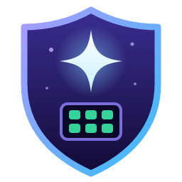
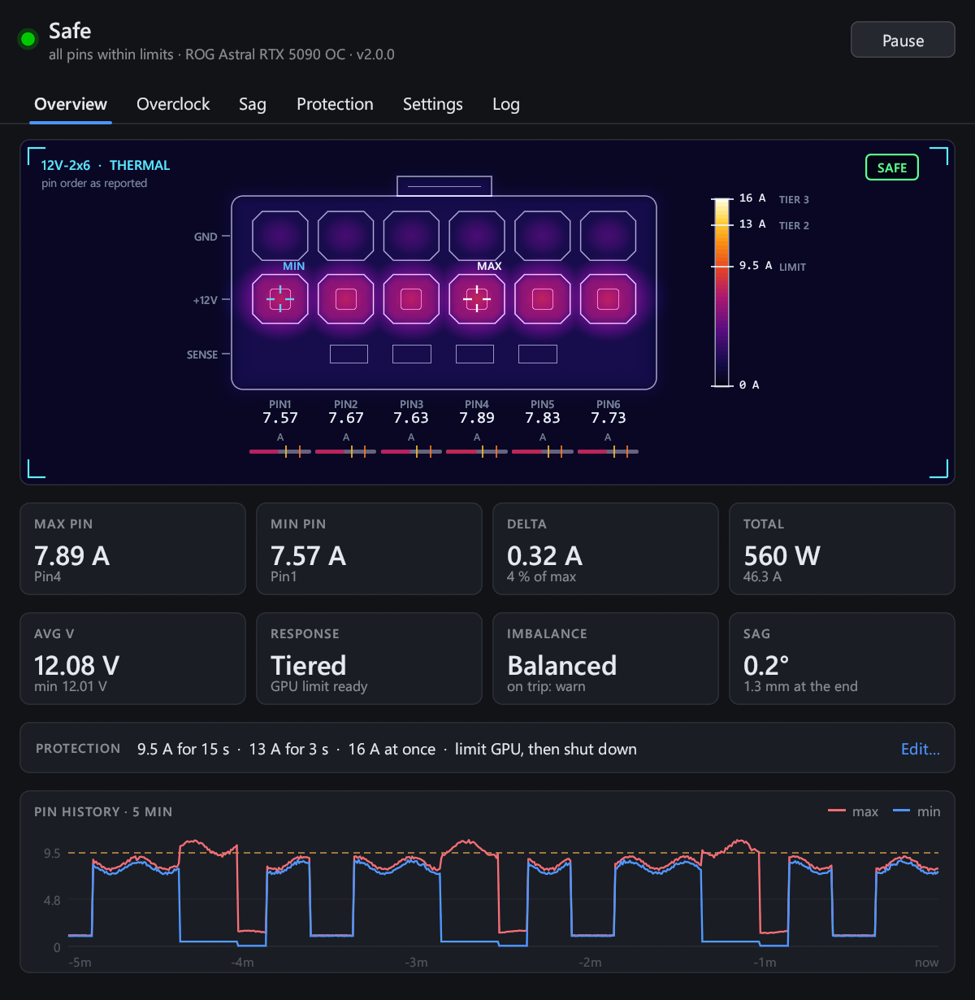
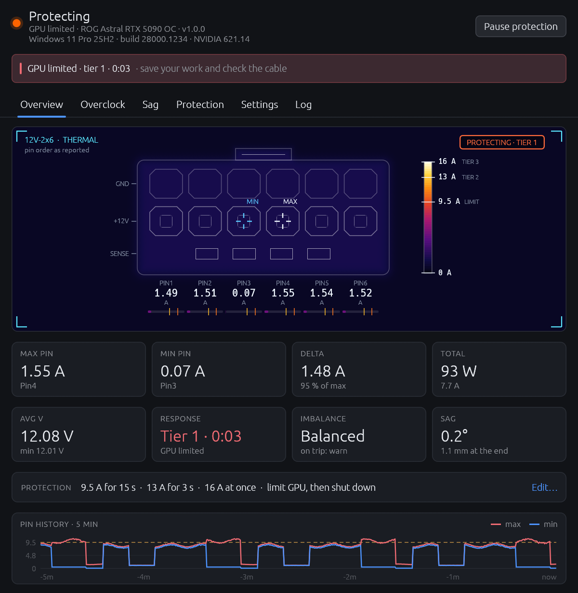
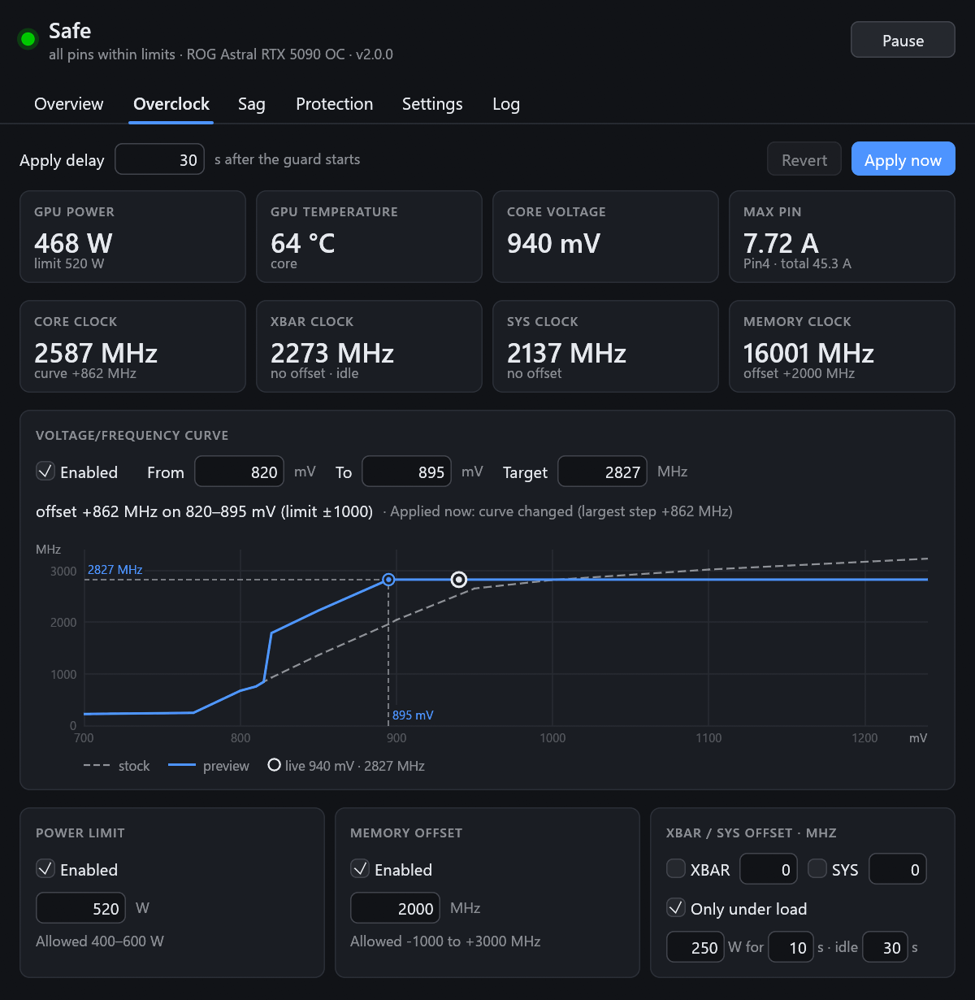
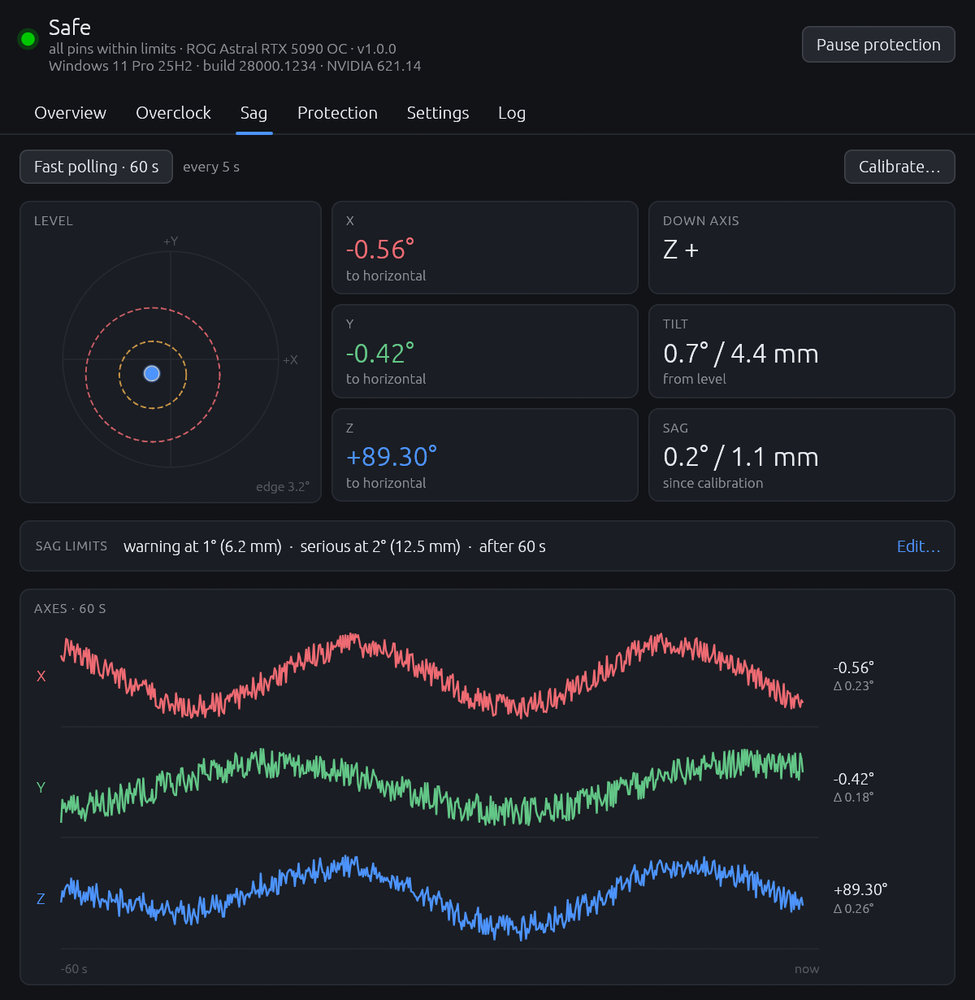
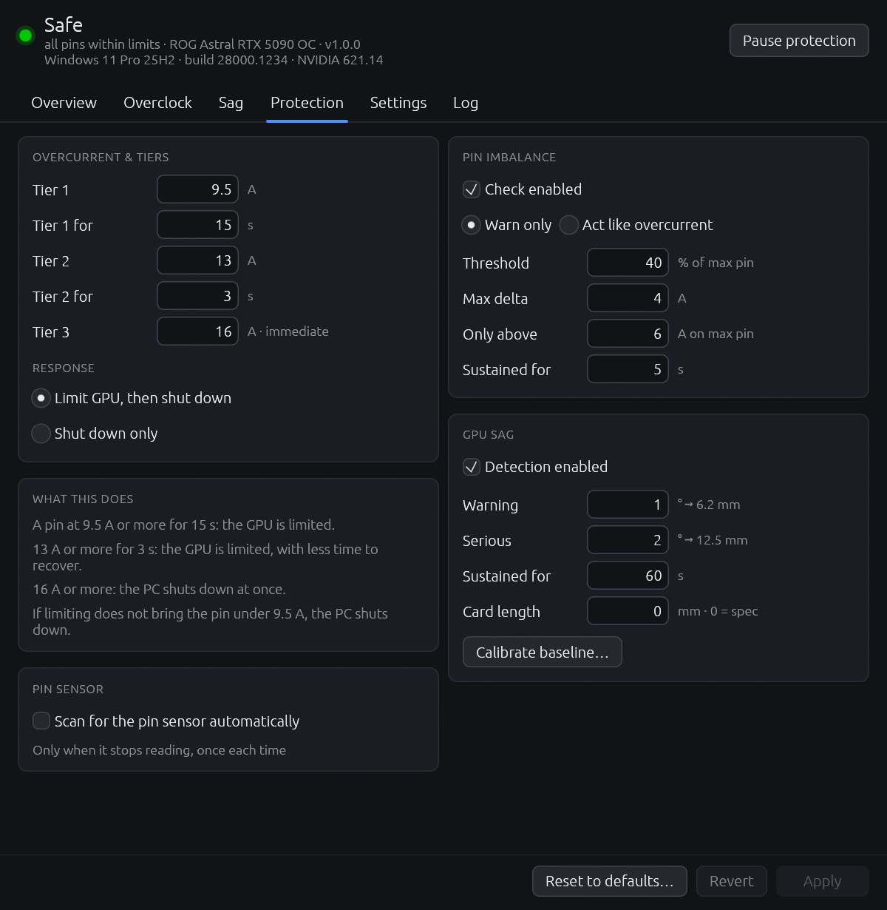
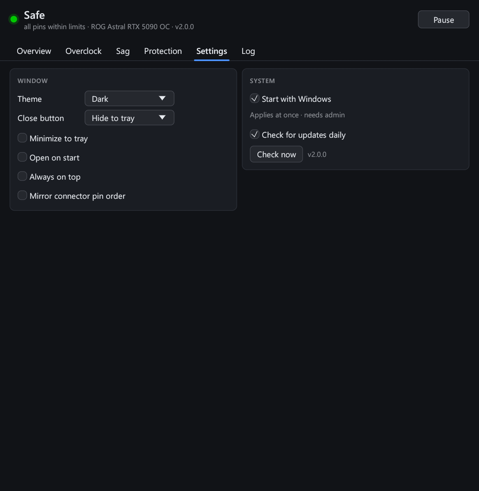
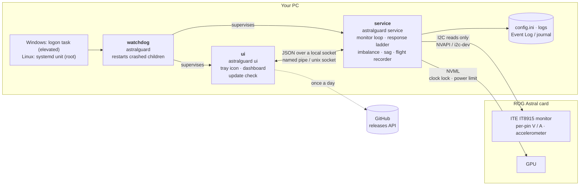

<p align="center">
  
</p>

<h1 align="center">AstralGuard</h1>

<p align="center">
  <b>Per-pin 12V-2x6 current protection for ASUS ROG Astral graphics cards.</b><br>
  Watches every 12 V pin of the power connector and steps in before a bad contact can melt it.
</p>

<p align="center">
  <a href="https://github.com/SzabolcsGergely/AstralGuard/actions/workflows/ci.yml"></a>
  <a href="https://github.com/SzabolcsGergely/AstralGuard/releases/latest"></a>
  
  <a href="LICENSE"></a>
</p>

---

The 12V-2x6 (12VHPWR) connector carries up to 600 W over six 12 V pins. If one pin makes poor
contact, the others pick up its share, and a pin running far above its rating heats the
plug until it melts. Cards usually only measure the total, so nothing notices until it
smells.

ASUS ROG Astral cards are different: a monitor chip on the board measures **each pin's
current and voltage**. AstralGuard reads that chip twice a second. When a pin runs hot, it
first **slows the GPU down** so the current drops within about a second, keeping your
session alive. It **shuts the machine down** only if that is not enough.

<p align="center">
  
  
</p>

## Contents

- [Features](#features)
- [Supported cards](#supported-cards)
- [Install](#install)
- [How it protects](#how-it-protects)
  - [GPU sag](#gpu-sag)
- [The dashboard and tray](#the-dashboard-and-tray)
- [Overclock](#overclock)
- [Configuration](#configuration)
- [Files, logs and events](#files-logs-and-events)
- [Command line](#command-line)
- [Troubleshooting](#troubleshooting)
- [Architecture](#architecture)
- [Reporting a bug](#reporting-a-bug)
- [Building from source](#building-from-source)
- [Disclaimer](#disclaimer)

## Features

- **Per-pin monitoring**: all six 12 V pins, current and voltage, every 0.5 s, read
  straight from the card's own monitor chip. No HWiNFO or GPU Tweak needed.
- **Graduated response**: limit the GPU first (clock lock + minimum power limit, fully
  reversible), shut down only when limiting does not fix it. Three tiers, from a sustained
  overload to a dead short.
- **Pin imbalance warning**: one pin drifting away from the others is the early sign of a
  bad contact, often long before anything runs over its limit.
- **GPU sag detection**: the card's accelerometer notices when it tilts away from its
  installed position, since a sagging card strains the connector.
- **Flight recorder**: the last minute of per-pin samples is saved whenever the guard acts.
  That's the evidence a bug report or RMA needs.
- **Built to keep running**: protection runs in its own headless process. A watchdog
  restarts anything that crashes, and the dashboard can't take protection down with it.
- **Tray icon and dashboard**: live thermal-style view of the plug, five minutes of
  history, the sag level, every setting, the log.
- **Optional overclock**: undervolt, power limit, memory offset and XBAR / SYS clock
  offsets, recorded and put back exactly, kept apart from protection.
- **Update check**: the dashboard tells you when a new release is out. It never downloads
  or installs anything by itself.
- **Windows and Linux**: a setup wizard on Windows, `.deb` and Arch packages on Linux.

## Supported cards

Every ASUS ROG Astral card: the RTX 5090 and 5080 Astral in all their versions (OC, White,
BTF, LC, Matrix, 5090D, Hatsune Miku). Only the Astral has the per-pin monitor chip, so no
other card is supported. The card is recognised automatically.

Verified on hardware: ROG Astral RTX 5090 OC (readings within 0.06 A of HWiNFO). The
others share the same monitor chip and are expected to work. If you have one, a
[card report](https://github.com/SzabolcsGergely/AstralGuard/issues/new?template=card_report.yml)
with the output of `astralguard probe` tells us whether it does.

## Install

Get the package for your system from the
[latest release](https://github.com/SzabolcsGergely/AstralGuard/releases/latest).
`SHA256SUMS.txt` on the release page has every file's checksum, and
[`CHANGELOG.md`](CHANGELOG.md) says what changed in each release.

### Windows 10 / 11

Run **`AstralGuard-<version>-setup.exe`**. It first asks who to install for:

| | Install for all users (recommended) | Install for me only |
|---|---|---|
| Program | `C:\Program Files\AstralGuard` | `%LOCALAPPDATA%\Programs\AstralGuard` |
| Start menu | everyone's | yours |
| Guard starts at sign-in for | every user who signs in, each in their own session | you |
| Administrator rights | for the whole setup | one UAC prompt, to create the logon task |

Unless you untick **Start AstralGuard when … signs in**, setup creates a logon task that
starts the guard elevated. Limiting the GPU needs administrator rights, and the task
provides them without a UAC prompt at every sign-in. Upgrades keep the choice you made
the first time.

The guard then lives in the tray. Hover the icon: `AstralGuard: Safe | Max 7.12A, Min
6.80A` means it is reading your card. Opening **AstralGuard** from the Start menu
brings up the dashboard, or starts the guard if it isn't running.

Silent install: `AstralGuard-<version>-setup.exe /VERYSILENT /ALLUSERS` (or
`/CURRENTUSER`; add `/TASKS=""` to skip the logon task).

The program is not code-signed yet, so SmartScreen may warn on first run ("More info" →
"Run anyway").

### Debian 12+, Ubuntu 22.04+

```sh
sudo apt install ./astralguard_<version>-1_amd64.deb
```

The service is enabled and started right away. The user who ran `sudo` joins the
`astralguard` group, which may use the tray and dashboard; they appear at the next login.
Add other users with `sudo usermod -aG astralguard <user>`.

### Arch Linux

```sh
sudo pacman -U astralguard-<version>-1-x86_64.pkg.tar.zst
sudo systemctl enable --now astralguard
sudo usermod -aG astralguard $USER    # then log out and back in
```

Or build it yourself with [`rust/packaging/linux/arch/PKGBUILD`](rust/packaging/linux/arch/PKGBUILD)
(`makepkg -si`).

> **Linux status: tested.** Used daily on a ROG Astral RTX 5090 OC with CachyOS (kernel 7.3,
> NVIDIA 620.70 open kernel module, KDE Plasma on Wayland): the pin monitor over SMBus and the
> sensor scan, the guard as a systemd service, the tray and dashboard, and the whole overclock
> (V/F curve, power limit, memory, XBAR / SYS, re-applied after a resume from sleep). The
> packages are built and install-tested in CI. On a new install, run `sudo astralguard probe`
> once and check that it prints about 12 V and sensible currents on every pin; if the pins
> don't read, see [Troubleshooting](#troubleshooting). On Wayland, **Always on top** is not
> offered: Wayland lets no program keep its own window above others (on KDE, the title bar's
> **More Actions → Keep Above Others** does it).

### Updating and uninstalling

- **Update**: install the new version over the old one. Settings, the sag baseline and logs
  are kept. The dashboard checks GitHub once a day and shows an **Update available** banner
  when there is a new release; turn that off in Settings → System.
- **Uninstall on Windows**: Settings → Apps → AstralGuard → Uninstall. That removes the
  program, the logon task and the Event Viewer source. Settings and logs stay in
  `C:\ProgramData\AstralGuard`.
- **Uninstall on Linux**: `sudo apt remove astralguard` or `sudo pacman -R astralguard`.
  Settings and logs stay in `/var/lib/astralguard`.

## How it protects

Every 0.5 s the service reads all six pins and takes the highest one (`max`). Three tiers
trigger independently; the defaults:

| Tier | Trigger | Response |
|---|---|---|
| 1 · overload | `max` ≥ **9.5 A** for **15 s** | Limit the GPU, give it **10 s** to work |
| 2 · critical | `max` ≥ **13 A** for **3 s** | Limit the GPU, give it **5 s** to work |
| 3 · catastrophic | `max` ≥ **16 A** on **2 samples in a row** | Shut down at once |

For scale: at 600 W a healthy connector carries about 8.3 A per pin, ASUS warns at 9.2 A,
documented slow-cook failures ran at 11–15 A, and the most-cited melted plug measured over 22 A.

What happens after a trip:

1. **Tier 1 or 2 trips: the GPU is limited** and gets a grace window (10 s for tier 1, 5 s
   for tier 2) to bring the pins down.
2. **Still over 9.5 A when the window ends: the PC shuts down.** Limiting didn't help, so
   something is wrong with the connector itself.
3. **Back under the limit:** the GPU stays limited for at least 2 minutes and is released
   after 60 s under 9.5 A.
4. **A new trip within 10 minutes of the release: the PC shuts down.** A fault that comes
   back is treated as persistent rather than ridden out again.
5. **Tier 3 skips all of this** and shuts down at once.

- **Limiting** locks the graphics clock to its floor and drops the power limit to the
  card's minimum through NVML (the API behind `nvidia-smi`). Both are put back exactly as
  they were on release. A marker file makes sure a crash while limited never leaves the
  card slowed down after a restart.
- **A fault that comes back** within 10 minutes of a release is treated as persistent, and
  the machine shuts down instead of riding it out again.
- **Shutdown** is `shutdown /s /t 5 /f` on Windows and `systemctl poweroff` on Linux. The
  next start reports that the last shutdown was an emergency stop, and why.
- **Shutdown-only mode** skips limiting entirely and keeps the same tiers and timings. It
  is also the fallback whenever GPU limiting is unavailable, for example without
  administrator rights.
- **Pin imbalance**: once a pin carries at least 6 A, a spread between the highest and
  lowest pin of 40 % or 4 A held for 5 s raises a warning. You can also set it to act like
  a tier 1 trip.
- **Sag**: warns when the card tilts away from its baseline position; it never touches
  the GPU. See [GPU sag](#gpu-sag).

### GPU sag

A heavy card bends down at its far end over time, and that pulls on the power connector.
The Astral has an accelerometer, so the guard can measure the card's angle.

**What it measures.** Sag is the change from a *baseline*: the card's angle at the moment
it was calibrated, in degrees and in millimetres at the far end of the card. The baseline is
not "perfectly level". It is the position you want the card to stay in. So it works whether
the card has a support bracket or not:

- **With a support** (a bracket, a stand, the case's own holder): the baseline is the
  supported position. A warning means the support slipped or was knocked.
- **Without a support**: the baseline is how the card hangs today. A warning means it is
  sagging further than when you calibrated.
- **Vertical mount**: works the same. A plumb card counts as "level".

**The first baseline is taken by itself.** On first start, if the card sits within 1.5° of
level (or of plumb), the guard takes its position as the baseline. If it sits further off,
it may already be sagging, so the guard does *not* take it. It warns instead (event 7007),
and sag detection waits until you calibrate. That is the moment to add a support or
straighten the card.

**Calibrate** (on the Sag tab) makes the card's current position the new baseline. It takes
about 10 s. Leave the PC where it normally stands and don't touch it meanwhile. Calibrate:

- after installing the card, or after adding or adjusting a support;
- after moving the PC or changing how it stands (the guard notices a sudden change and
  asks you to);
- when the first-start warning said the card was off level, once it is supported.

Don't calibrate just to silence a sag warning. That only makes today's sag the new normal.
Fix the sag first, then calibrate.

**When it warns:**

| What | Default | Event |
|---|---|---|
| Sag warning | 1° from the baseline, held for 60 s | 7001 |
| Serious sag | 2° from the baseline, held for 60 s | 7002 |
| Sudden change | a jump of 1° or more between two samples (the PC was moved or knocked), and the card still 1° off its baseline a minute later. Recalibrate if you moved it on purpose | 7003 |
| Slow creep | 0.3° more than 7 to 30 days earlier, from the daily median in `sag_history.csv` | 7004 |

A sample is taken every 5 s and judged as a one-minute median, so vibration and fans don't
count. Moving a different card in re-takes the baseline. The limits are on the Protection
tab; the millimetre figure uses the card's length from ASUS's spec (`sag_card_length_mm`
overrides it).

### Status

| Tray | Status | Meaning |
|---|---|---|
| 🟢 | **Safe** | All pins within limits |
| 🟠 | **Warning** | A pin is over the threshold; the sustained timer is running |
| 🟧 | **Protecting** | The GPU is limited |
| 🔴 | **Danger** | Shutting down |
| 🔵 | **Unprotected** | Protection is paused (from the tray or dashboard) |
| ⚪ / 🟣 | **Unknown** | No pin readings: no supported card, or the chip stopped answering |

## The dashboard and tray

<p align="center">
  
  
  
  
</p>

- **Overview**: a thermal-camera style view of the plug (colour = current, scaled to the
  thresholds), max / min / delta / total power, average voltage, response state,
  imbalance and sag, the protection thresholds in one line, and five minutes of history.
- **Overclock**: an optional undervolt, power limit, memory offset and XBAR / SYS offsets
  ([below](#overclock)), with what the card runs now, refreshed every second: one row for
  power (GPU power draw, GPU temperature, core voltage, the highest pin and the connector's
  total) and one for clocks (core, XBAR, SYS and memory, each with its offset). NVML reports
  no VRAM temperature on GeForce cards, so there is none.
- **Sag**: bubble level, the card's angle on each axis, sag against the baseline, the sag
  limits in one line, and a minute of history. **Calibrate** makes the current position the
  baseline ([when to use it](#gpu-sag)).
- **Protection**: every protection value (checked, and confirmed when it weakens
  protection) and the response mode, with the ladder they give in words. The one place
  protection is changed; **Edit…** on Overview and Sag leads here.
- **Settings**: theme, window behaviour, autostart, update check. These apply at once.
- **Log**: the guard's log and the flight recorder dumps.

The **tray icon** is a dot in the status colour. Its menu: **Open Dashboard**, **Open
Log**, **Pause protection / Resume protection**, **Exit**. Pausing is visible everywhere and
reminds you every 30 minutes. It pauses only the connector protection: an overclock stays
applied and keeps working (the start-up apply, Apply now, XBAR / SYS only under load).

## Overclock

The **Overclock** tab is optional and separate from protection. Each setting has its own
tick box, and a setting that is not ticked is never touched:

- **Undervolt**: raises the V/F curve between two voltages, so the card reaches the target
  clock at a lower voltage.
- **Power limit**: the board power limit in watts.
- **Memory offset**: in Afterburner units. AstralGuard sends twice the number to the driver,
  so `2000` here is what the driver calls `4000`.
- **XBAR / SYS offset**: the crossbar and SYS clocks, in MHz. A raised XBAR keeps the core
  from dropping to its idle clock, so **Only under load** (on by default) applies the offsets
  only after the GPU has drawn at least 250 W for 10 s, and puts them back after 30 s below
  that. Raised XBAR clocks have been reported to cause display corruption; raise it in small
  steps.

The undervolt and XBAR / SYS use undocumented driver calls, so before the first real write on
each driver version AstralGuard writes a small test offset (+15 MHz), reads everything back,
checks that only that value changed, and undoes it. If anything else moved, that setting
stays off on that driver version. Offsets beyond ±1000 MHz are refused, not clamped, and
every write is read back.

AstralGuard records what it changed and the value from before, and unticking a setting puts
that value back. Quitting leaves the overclock in place; the driver drops it at reboot. If the
guard trips while an overclock is active, the log and the flight dump say so.

<details>
<summary>How applying and restoring works</summary>

**The checks.** The undervolt uses NVIDIA's NVAPI curve calls: the test writes 15 MHz to one
point in the middle of the curve (the driver does not apply a 5 MHz offset), reads the whole
curve back, the offsets and separately the clocks the driver reports, and restores it. The
undervolt is also refused while a core clock offset is set outside AstralGuard. XBAR / SYS go
through the driver's clock-domain control (on Linux through `/dev/nvidiactl`): the test
writes +15 MHz to XBAR alone and compares the control block of every clock domain before and
after. A failed check turns off only that one setting. Raised XBAR clocks cause display
corruption without extra voltage, which recent drivers do not apply.

**Restoring.** What AstralGuard changed, the value it applied and the value from before are
kept in `overclock.active`, next to `mitigation.active`. Unticking a setting puts the old value
back only for a setting AstralGuard applied itself, and only while the card still runs the
value AstralGuard applied: after a reboot, or a change by another tool, the card's current
value is left as is. A marker written for another card is ignored.

**When it applies.** **Apply now** saves and writes in one step, and changes only the
overclock settings. While the guard is limiting the GPU it is refused and nothing is saved; if
the guard starts limiting between the save and the write, the settings stay saved and are
applied when the guard releases the GPU. At start the saved settings are applied once, after
`oc_apply_delay_seconds`; if the GPU is limited by then, or cannot be opened, the service
retries every 30 s. They are applied again after every release from limiting, and after a
resume from sleep (the driver puts the power limit back to stock on wake-up). Values already
in effect are not rewritten.

**Effect on protection.** Every overclock call runs on the service's monitor thread, so it
never overlaps the guard's own limit, and the pin reads wait for it. A call that takes longer
than 250 ms is logged with its duration, and the dashboard shows **Guard loop not
responding** when the loop has not moved for more than 5 s. With nothing ticked and nothing
managed, the overclock makes no NVML or NVAPI calls at all, and the tab reads the GPU only
while it is open (every 2 s).

**Verified.** The NVAPI curve layouts on Linux (2026-11-09, ROG Astral RTX 5090 OC, driver
620.70.06) and Windows (2026-11-10, same card, driver 621.14), the core voltage readout
included. The XBAR and SYS controls on Windows (2026-11-10, driver 621.14) and Linux
(2026-11-11, driver 620.70.06): the write check, applies, unticks back to +0 MHz and the clock
readouts.

</details>

## Configuration

Settings live in `config.ini`. Edit them from the dashboard: it validates every value,
applies it at once, and keeps any keys and comments it doesn't know. To edit the file by
hand, stop the guard first.

| Key | Default | Meaning |
|---|---|---|
| `threshold_amps` | `9.5` | Tier 1 threshold per pin |
| `sustained_seconds_required` | `15` | How long tier 1 must hold |
| `response_mode` | `tiered` | `tiered` (limit, then shut down) or `shutdown_only` |
| `critical_amps` / `critical_seconds` | `13` / `3` | Tier 2 |
| `catastrophic_amps` | `16` | Tier 3 (two samples in a row) |
| `mitigation_grace_seconds` | `10` | Tier 1: time for the limit to work |
| `mitigation_clear_seconds` | `60` | Time under the threshold before releasing |
| `mitigation_min_hold_seconds` | `120` | Minimum time limited |
| `retrigger_window_seconds` | `600` | A new trip this soon after a release shuts down |
| `imbalance_enabled` | `true` | Pin imbalance check |
| `imbalance_min_amps` | `6` | Only judged once a pin carries this much |
| `imbalance_percent` / `imbalance_delta_amps` | `40` / `4` | Trip on either |
| `imbalance_sustained_seconds` | `5` | How long the spread must hold |
| `imbalance_response` | `warn` | `warn`, or `act` (treat as a tier 1 trip) |
| `sag_enabled` | `true` | Sag detection |
| `sag_warn_degrees` / `sag_serious_degrees` | `1` / `2` | Tilt from the baseline |
| `sag_sustained_seconds` | `60` | How long the tilt must hold |
| `sag_card_length_mm` | `0` | For the mm figure; `0` = the detected card's spec |
| `sensor_auto_scan` | `false` | Linux: scan for the pin monitor by itself when the card is found but its pins stop reading, once each time (not at every start) |

<details>
<summary>Overclock keys</summary>

| Key | Default | Meaning |
|---|---|---|
| `oc_uv_enabled` | `false` | Overclock: apply the undervolt |
| `oc_uv_from_mv` / `oc_uv_to_mv` | `820` / `895` | Voltage range the undervolt covers (mV) |
| `oc_uv_target_mhz` | `2827` | Clock the card should reach across that range |
| `oc_power_enabled` | `false` | Overclock: apply the power limit |
| `oc_power_w` | `520` | The power limit (W) |
| `oc_mem_enabled` | `false` | Overclock: apply the memory offset |
| `oc_mem_offset_mhz` | `2000` | Memory offset in Afterburner units (the driver gets twice this) |
| `oc_apply_delay_seconds` | `30` | Wait after the service starts, or the machine wakes up, before applying the overclock |
| `oc_xbar_enabled` / `oc_xbar_offset_mhz` | `false` / `0` | Overclock: the XBAR clock offset (MHz) |
| `oc_sys_enabled` / `oc_sys_offset_mhz` | `false` / `0` | Overclock: the SYS clock offset (MHz) |
| `oc_clk_load_only` | `true` | Apply XBAR / SYS only under load |
| `oc_clk_load_watts` / `oc_clk_load_seconds` | `250` / `10` | Under load: at least this many W for this long |
| `oc_clk_idle_seconds` | `30` | Back to idle after this long below the threshold |

</details>

<details>
<summary>Keys the guard writes itself</summary>

The sag baseline (`sag_baseline`, `sag_baseline_subsystem`) is written by **Calibrate** and
re-taken automatically when a different card is installed. `oc_vf_verified_driver` is written
by the service after the undervolt's compatibility check passes, so the check runs again only
after a driver update. `oc_vf_failed_driver` is written when the check finds a write landing
in the wrong place: on that driver version the check does not run again and the undervolt stays
off until a driver update (or until the key is removed). `oc_clk_verified_driver` and
`oc_clk_failed_driver` do the same for the XBAR / SYS write check. On Linux, **Scan** saves
the adapter that carries the pin monitor (`i2c_adapter`, `i2c_adapter_subsystem`).

</details>

Window preferences (theme, size, which tab, pin order, close action, update check) are kept per user in
`%APPDATA%\AstralGuard\ui.json` / `~/.config/astralguard/ui.json`.

## Files, logs and events

| | Windows (installed) | Linux |
|---|---|---|
| Settings | `C:\ProgramData\AstralGuard\config.ini` | `/var/lib/astralguard/config.ini` |
| Log (rotates at 2 MB, keeps 5) | `…\logs\astralguard.log` | `/var/lib/astralguard/logs/astralguard.log` |
| Watchdog / crash traces | `…\logs\watchdog.log`, `crash_trace.log` | `logs/crash_trace.log`; restarts in the journal (`journalctl -u astralguard`) |
| Flight recorder | `…\logs\flight_<time>_<event>.csv` | same, under `logs/` |
| Daily sag median | `…\logs\sag_history.csv` | same, under `logs/` |
| GPU limit / overclock markers | `mitigation.active`, `overclock.active` (data folder) | same, `/var/lib/astralguard` |
| Last emergency shutdown | `last_shutdown.json` (data folder) | same |
| Installer steps | `…\logs\setup.log` | none |

A copy of `astralguard.exe` with a `config.ini` next to it keeps everything in its own
folder (portable use). `ASTRALGUARD_HOME` overrides the location.

On Windows, important events also go to the **Event Viewer** (Windows Logs → Application,
source *AstralGuard*):

<details>
<summary>Event IDs</summary>

| ID | Event |
|---|---|
| 1000 / 1003 | Started / stopped |
| 1002 / 1004 | Card connected / sensor lost |
| 1005 | Restarted after a crash |
| 3001 / 3002 | Pin over the threshold / still over |
| 4001 | Load cleared, timer reset |
| 5090 | Emergency shutdown |
| 5091 | The last shutdown was an emergency stop (reported at the next start) |
| 6001 | Critical current (tier 2) |
| 6002 | GPU limited (tier 1 or 2) |
| 6003 | The limit brought the current down; holding |
| 6004 | Tiered mode selected, but the GPU cannot be limited: running shutdown-only |
| 6005 | GPU limit released |
| 6006 | Restored a GPU limit left by a crash (`mitigation.active`) |
| 7001 / 7002 | GPU sag warning / serious |
| 7003 | Card orientation changed suddenly |
| 7004 | Sag creeping up over weeks |
| 7005 | Sag baseline calibrated |
| 7006 | Sag back to normal |
| 7007 | Card off level at first start: baseline not taken, calibrate |
| 8001 / 8002 | Pin imbalance / cleared |
| 9001 | Error: the monitor loop or an overclock step panicked (the guard carries on) |

</details>

On Linux the same events go to the journal as `[id] message`.

## Command line

| Command | |
|---|---|
| `astralguard` | Watchdog + service + tray. Started again while running, it opens the dashboard. |
| `astralguard watchdog [--no-ui]` | The watchdog explicitly; `--no-ui` supervises the service only |
| `astralguard service` | The service alone (what systemd runs on Linux) |
| `astralguard ui [--show]` | Tray and dashboard alone |
| `astralguard ui --demo` | Dashboard with a simulated card: no hardware, no service |
| `astralguard probe` | Print the OS and NVIDIA driver, then read the card a few times: pins, volts, tilt and the XBAR / SYS offsets. Read-only, safe next to a running guard. |
| `astralguard probe --detect [--dry-run]` | Linux: find the I2C adapter that carries the pin monitor and save it (what the dashboard's **Scan** does) |
| `astralguard status [--exit]` | Ask the running service for its state, or stop it (elevated / root) |
| `astralguard register [--all-users]` / `unregister` | Windows, elevated: create / remove the logon task (for this user, or for everyone who signs in) and the Event Log source. The installer uses these. |

## Troubleshooting

- **Tray says *Unknown (waiting for pin sensors)***: the card could not be read. Check that
  it is a supported Astral card and the NVIDIA driver is loaded; the log says why.
  `astralguard probe` shows exactly what the chip answers.
- **Banner says *Pin sensor not reading*** (Linux): the card is there but its pin monitor
  gives no valid data. The pins are read through the NVIDIA driver's I2C adapters
  (`/dev/i2c-*`); on the verified card adapter 1 carries the monitor chip. Press **Scan** (or
  run `sudo astralguard probe --detect`): it tries the card's own adapters, keeps the one that
  shows 12 V on every pin, about 1 g on the accelerometer and a total that matches NVML's board
  power, and saves it (`i2c_adapter` in `config.ini`, used only while the same card sits at the
  same PCI address). The result lists what each adapter answered. Tick **Scan automatically
  next time** and the guard does this by itself the next time the pins stop reading, for
  example after a driver update. `ASTRALGUARD_I2C_BUS=<n>` in a systemd drop-in selects an
  adapter explicitly.
- **Banner says *GPU limiting unavailable* (Response: *Shutdown only*)**: the guard is not running
  elevated (Windows) or as root (Linux), so it can only shut down. Start it through the
  logon task (Start menu) or the systemd unit.
- **The dashboard says *Guard service not running***: on Windows, start AstralGuard from
  the Start menu. On Linux your user is probably not in the `astralguard` group yet, or
  hasn't logged in again since joining.
- **Pin numbers look mirrored**: which physical socket is "Pin1" has not been verified.
  Settings → Window → **Mirror connector pin order** flips the drawing. Protection doesn't
  depend on it.

## Architecture

AstralGuard is a single Rust program, `astralguard`, that runs as separate processes. The
protection decision lives in a headless service that nothing else can block.

<details>
<summary>Diagram</summary>



</details>

| Process | Role |
|---|---|
| **watchdog** (`astralguard`) | What the logon task starts. Runs the service and the UI as children in a kill-on-close job object and restarts either one if it crashes (after 5, 10, 30, then 60 s). Touches no hardware, so it has nothing that could crash it. |
| **service** (`astralguard service`) | The protection core: reads the pins, runs the response ladder, limits the GPU, shuts down. Also runs the imbalance and sag checks, the flight recorder and the logs. Headless and makes no network connections. |
| **ui** (`astralguard ui`) | Tray icon and dashboard (egui). A client of the service, nothing more: if it hangs or crashes, protection carries on. |

The service and the UI talk over a local socket: one JSON request, one JSON response. On
Windows it is a named pipe that only elevated processes can write to, so an ordinary
program cannot pause the guard. On Linux it is `/run/astralguard/astralguard.sock`, open
to root and the `astralguard` group. On Linux, systemd does the watchdog's job
(`Restart=on-failure`) and the UI starts from the desktop session's autostart. There
the tray is its own process and the dashboard window another one (`astralguard ui
--window`), started from the tray and gone when it is closed: Wayland gives an app no way
to hide its window. The tray is a StatusNotifierItem: left click opens the dashboard,
right click the menu.

**Read-only hardware access.** The sensor code only ever sets a register pointer and reads
from the monitor chip at I2C address `0x2B`; it never writes a data register. NVAPI's I2C
write function is deliberately not bound at all. Protection limits the GPU through NVML
only, the documented driver API. The optional [overclock](#overclock) is the only part that
uses undocumented driver calls, and only behind its checks.

## Reporting a bug

Open an issue with the
[bug report form](https://github.com/SzabolcsGergely/AstralGuard/issues/new?template=bug_report.yml).
It asks for what is needed to reproduce the problem:

- the AstralGuard version, the OS and the NVIDIA driver (all three in the dashboard header),
  how it is installed, and the card;
- what happened and what you expected, with a screenshot of the dashboard if it shows it;
- the lines around the problem from `astralguard.log`, and `crash_trace.log` after a crash
  (see [Files, logs and events](#files-logs-and-events));
- if the guard limited the GPU or shut down: the flight recorder CSV from that moment;
- for anything about pin readings: the output of `astralguard probe`, which also prints the
  OS and the driver.

Logs contain file paths with your user name; look through them before attaching. An Astral
card that is not on the verified list gets a
[card report](https://github.com/SzabolcsGergely/AstralGuard/issues/new?template=card_report.yml),
working or not. Ideas go in a
[feature request](https://github.com/SzabolcsGergely/AstralGuard/issues/new?template=feature_request.yml).

## Building from source

```sh
git clone https://github.com/SzabolcsGergely/AstralGuard
cd AstralGuard/rust
cargo build --release
```

[`CLAUDE.md`](CLAUDE.md) is the contributor guide: toolchains for Windows and Linux,
the Linux build dependencies, tests and lints, the code layout, the safety rules the code
follows, packaging and how releases are cut. Pull requests get a checklist of the same.

## Disclaimer

AstralGuard is an independent project. It is **not affiliated with, endorsed by or
supported by ASUS or NVIDIA**; ROG and Astral are trademarks of ASUSTeK Computer Inc.

It reduces risk; it does not remove it. It cannot see a problem the card's sensors cannot
measure: temperature at the plug, a damaged cable, or the PSU side of the connector. It
needs to be running to help. A connector that ever triggers it should be inspected and
reseated or replaced. The software is provided as is, under the [MIT license](LICENSE),
without warranty of any kind; you use it at your own risk.

Large parts of this project were written with AI assistance (Claude) and reviewed and
tested on real hardware by the author.
